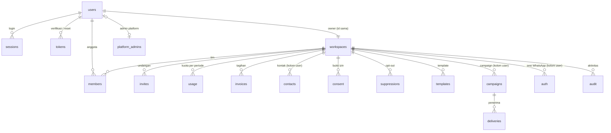

# Database WABlast

WABlast memakai **SQLite** (bawaan Node.js, `node:sqlite`) dalam satu file: `data/app.sqlite`. Di Docker, file ini ada di volume `app-data` (`/app/data/app.sqlite`). Tidak perlu server database terpisah.

- **Skema lengkap:** [`db/schema.sql`](../db/schema.sql). Dikelompokkan per fungsi, setiap tabel dan kolom diberi komentar.
- **Sumber kebenaran:** migrasi di `src/store.js`. Aplikasi membuat dan memperbarui database sendiri saat start, jadi `schema.sql` tidak perlu dijalankan manual.
- **Penjaga:** `test/schema.test.js` gagal kalau `schema.sql` berbeda dari hasil migrasi. Setiap mengubah skema, perbarui keduanya.

## Konvensi

| Hal | Aturan |
| --- | --- |
| ID | UUID teks (kecuali `audit.id` angka berurutan) |
| Waktu | epoch milidetik (`INTEGER`) |
| Nomor HP | format internasional tanpa `+`, contoh `628123456789` |
| Uang | rupiah penuh (`INTEGER`) |
| Boolean | `0` / `1` |
| ID workspace | sama dengan ID user owner-nya |
| Data rahasia | `auth.value`, `mail.payload`, `platform_settings.payload` terenkripsi AES-256-GCM dengan `SESSION_ENCRYPTION_KEY` |

> **Perhatian:** di tabel `contacts`, `campaigns`, dan `auth`, kolom bernama `user` sebenarnya berisi **ID workspace**. Nama ini warisan versi awal dan dipertahankan agar data lama tetap kompatibel.

## Relasi antar tabel



## Tabel per fungsi

| Fungsi | Tabel | Isi |
| --- | --- | --- |
| Akun & login | `users` | Akun login: email, hash password, status verifikasi |
| | `sessions` | Sesi browser (hash token cookie) |
| | `tokens` | Token email sekali pakai: `verify`, `reset` |
| Workspace & langganan | `workspaces` | Bisnis pelanggan: paket, status, periode aktif |
| | `members` | Anggota tim dan role: `owner`, `admin`, `operator` |
| | `invites` | Undangan anggota yang belum diterima |
| | `usage` | Kuota penerima terpakai per periode |
| | `invoices` | Tagihan transfer manual |
| Kontak | `contacts` | Penerima: nama, nomor, `optin` |
| | `consent` | Sumber persetujuan tiap nomor |
| | `suppressions` | Nomor opt-out (STOP/BERHENTI/UNSUBSCRIBE atau manual) |
| Pesan | `templates` | Pesan siap pakai |
| | `campaigns` | Kirim massal: pesan, status, jadwal |
| | `deliveries` | Satu baris per penerima, status pengiriman |
| WhatsApp | `auth` | Kredensial sesi Baileys per workspace (terenkripsi) |
| Platform | `platform_admins` | Akun admin platform |
| | `platform_settings` | Brand, SMTP, rekening, harga (1 baris, terenkripsi) |
| | `bootstrap` | Tautan setup admin pertama |
| Sistem | `mail` | Antrean email keluar |
| | `audit` | Catatan aktivitas |
| | `schema_migrations` | Versi migrasi yang sudah jalan |

## Alur status

**Campaign** (`campaigns.status`)

```
queued ──► running ──► completed
   │          │
   │          ▼
   └──────► paused ──► running
   (semua) ─────────► cancelled
```

`running` otomatis menjadi `paused` bila koneksi WhatsApp bermasalah atau server restart.

**Penerima** (`deliveries.status`): `pending` → `sending` → `sent`. Bila hasil tidak pasti: `unknown` (tidak pernah dikirim ulang otomatis). Bila nomor opt-out atau kontak dihapus: `skipped`.

**Invoice** (`invoices.status`): `pending` → `review` (pelanggan konfirmasi transfer) → `paid` (admin setujui) atau `rejected`. Bisa juga `cancelled`, atau `expired` bila lewat batas bayar.

## Menambah perubahan skema

1. Tambahkan migrasi **baru** di akhir array `migrations` di `src/store.js`. Jangan mengubah migrasi lama, karena server yang sudah berjalan tidak akan menjalankannya ulang.
2. Terapkan perubahan yang sama di `db/schema.sql`, lalu tambah nomor versinya di `INSERT INTO schema_migrations` paling bawah.
3. Perbarui angka jumlah migrasi di `test/migration.test.js` dan `test/schema.test.js`.
4. Jalankan `npm test`.

## Backup & melihat isi database

Backup aman saat aplikasi berjalan:

```bash
sudo docker compose exec -T app node scripts/backup.js /app/data/backup.sqlite
sudo docker compose cp app:/app/data/backup.sqlite ./backup.sqlite
```

File `backup.sqlite` bisa dibuka dengan [DB Browser for SQLite](https://sqlitebrowser.org/) atau `sqlite3 backup.sqlite`. Buka salinan backup, jangan file `app.sqlite` yang sedang dipakai aplikasi.
